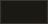
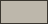
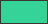
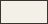
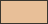
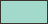
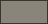
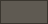

<p align="center">
  
</p>

<h1 align="center">Brand guideline</h1>

<p align="center">How everything Variable Lab publishes looks and reads.<br>Variable Lab is the open source arm of Variable Land.</p>

## At a glance

- **Dark, warm and flat.** One dark palette, no gradients, no shadows, square corners.
- **One Signature.** The green Logo with "Variable Land" beside it. No Project carries it.
- **A Sign per Project.** A Project starts with its Class stamp and earns a Sign: filled rectangles in one ink.
- **Facts, in English.** Short declarative sentences a reader can check in the code.

## Palette

<!-- build:color -->
|  | Token | Value | Use |
| --- | --- | --- | --- |
|  | `ground` | `#14120e` | Page background. |
|  | `surface` | `#1b1914` | Code blocks, command boxes and panels. |
|  | `ink` | `#f3f0e8` | Main text, Signs and Class stamps. |
|  | `ink-muted` | `#bdb7ab` | Secondary prose, such as the paragraph under a title. |
|  | `dim` | `#a39e93` | Subtitles, meta, labels and secondary links. |
|  | `rule` | `#2e2a24` | 1px rules and borders. |
|  | `rule-strong` | `#3a362f` | Link underlines, hover borders, selection and scrollbars. |
|  | `logo` | `#36d399` | The Logo, and nothing else. |
<!-- /build:color -->

Code is colored with soft Vesper: the roles and the peach and mint accents of [Vesper](https://github.com/raunofreiberg/vesper), on the palette's own warm neutrals.

<!-- build:syntax -->
|  | Token | Value | Use |
| --- | --- | --- | --- |
|  | `text` | `#f3f0e8` | Identifiers, punctuation and flags. |
|  | `keyword` | `#a39e93` | `import`, `from`, `const`, `export`, `as` and operators; JSX attributes; a code block's file name. |
|  | `function` | `#e8bf98` | Function calls and declarations; numbers, booleans, types and other `support.*` names; HTML tags and attributes; JSON keys; the first token of a shell command (`pnpm`). |
|  | `string` | `#a3d9ca` | Strings, symbols and `constant.other.key`; the arguments of a shell command (`init`, package names). |
|  | `comment` | `#8a857b` | Comments; a code block's language label. |
|  | `gutter` | `#5f5a52` | Line numbers and the `$` prompt. |
<!-- /build:syntax -->

## Type

IBM Plex Sans for text and IBM Plex Mono for code, both in 400 and 500. Two weights: 500 for names and titles, 400 for everything else.

## Shapes

<p>
  
  &nbsp;
  
</p>

The Class stamps of an App and a Library: a body on a base, and a closed frame. Each Project's Sign is drawn on the same 24×24 grid and lives in that Project's own repository, in `brand/`.

## The guideline

| Chapter | Covers |
| --- | --- |
| [Principles](skills/vlab-brand/principles.md) | The rules every other chapter follows. |
| [Logo](skills/vlab-brand/logo.md) | Color, the Signature, sizes and what to avoid. |
| [Color](skills/vlab-brand/color.md) | The palette, soft Vesper and contrast. |
| [Typography](skills/vlab-brand/typography.md) | Families, scale and text flow. |
| [Voice](skills/vlab-brand/voice.md) | Tone, names and how to say what a Project is. |
| [Iconography](skills/vlab-brand/iconography.md) | UI icons and shapes beside text. |
| [Project brand](skills/vlab-brand/project-brand.md) | Class stamps, how a Sign is drawn and a Project's `brand/` folder. |

The guideline is also an [Agent Skill](https://agentskills.io), `vlab-brand`, so agents read the same text people do.

## Use it

In any repository that publishes something for Variable Lab, install the skill and pick your agents:

```sh
npx skills add withvariablelab/brand --skill vlab-brand
```

For the tokens and the assets in code, add the package with the IBM Plex fonts beside it:

```sh
pnpm add @variablelab/brand @fontsource/ibm-plex-sans @fontsource/ibm-plex-mono
```

```css
@import "@variablelab/brand/theme.css"; /* Tailwind v4: bg-ground, text-ink, font-mono… */
@import "@variablelab/brand/tokens.css"; /* plain CSS: var(--vlab-ground)… */
```

## License

The code and the tokens are [MIT](LICENSE). The Logo, the Class stamps and the Signs are not: see [BRAND-USE.md](BRAND-USE.md).
